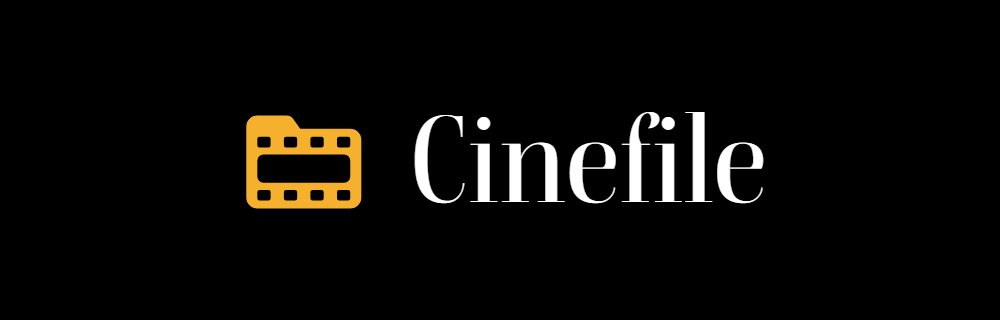

# Cinefile

React 19 + Vite + Tailwind v4 frontend for Cinefile. All data comes from the Cinefile API
(`../MovieGeeksBE`); the browser never talks to TMDB directly.

## Run it

```bash
npm install
cp .env.example .env    # VITE_API_URL, defaults to http://localhost:5000/api
npm run dev             # http://localhost:5173 (the API allows this origin)
npm run build && npm run preview -- --port 5173
```

## Where things are

- `src/Components/Pages`: one file per route; `src/Routing/AppRoutes.jsx` lazy-loads them.
- `src/Components/Home`, `Movie`, `UI`, `Layout`: page sections, film components, primitives, shell.
- `src/Services`: the API client (token refresh), per-area API calls, image URLs, guest wishlist.
- `src/Context`: session (`AuthContext`) and toasts; `src/Hooks`: shared data hooks.
- Design tokens (colours, type, steps) are in `src/index.css` under `@theme`.

Guests can browse everything and keep a wishlist in the browser; it merges into their account when
they sign in.

## Brand



The mark is a strip of film filed in a folder: *cine* + *file*. It is one amber shape (`#f5b02e`)
with the sprocket holes and frame cut through it, so it sits on any background.

| File | Use |
| --- | --- |
| `brand/cinefile-mark.svg` | The mark in amber, for dark backgrounds (the app uses this) |
| `brand/cinefile-mark-ink.svg` | One-colour dark version for light backgrounds and print |
| `brand/cinefile-icon.svg`, `public/favicon.svg` | The mark on a black rounded tile: favicon and app icon |
| `public/apple-touch-icon.png`, `public/icon-192.png`, `public/icon-512.png` | Home-screen and install icons |
| `brand/cinefile-logo-dark.png`, `-light.png`, `-transparent.png` | Mark and wordmark lockups |

The wordmark is "Cinefile" in Boska Medium; in the app it is set live by `Components/Layout/Wordmark.jsx`.
Keep clear space around the lockup of at least the height of the folder tab, and don't recolour,
rotate or outline the mark.
